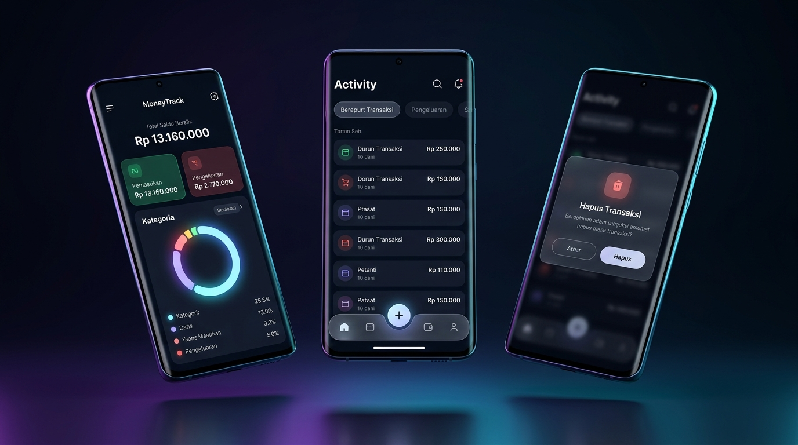
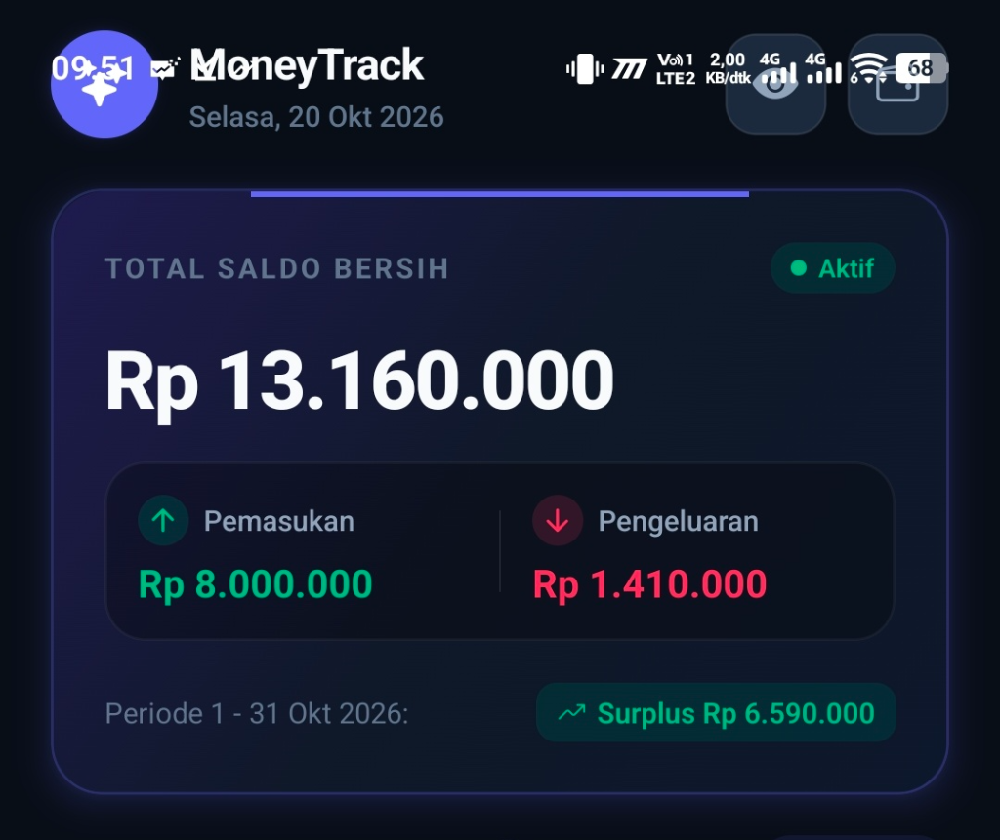
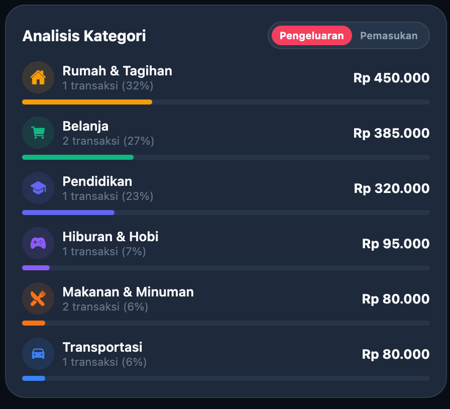

<div align="center">

  

  # MoneyTrack 💳✨
  
  **Aplikasi pencatat keuangan dan pengeluaran harian berbasis React Native & Expo**
  
  [](https://reactnative.dev)
  [](https://expo.dev)
  [](https://www.typescriptlang.org)
  [](https://docs.expo.dev/eas-update/introduction/)
  [](LICENSE)

  <br />

  

  <p align="center">
    <a href="https://expo.dev/artifacts/eas/t_Hk9hLB3agWNty34L_apTekRRP_1hlgZvNXkrchDsE.apk">
      
    </a>
  </p>

</div>

---

## 📖 Tentang MoneyTrack

**MoneyTrack** adalah aplikasi mobile untuk mencatat keuangan dan pengeluaran harian secara praktis dan rapi. Dibuat menggunakan **React Native**, **Expo**, dan **TypeScript**, aplikasi ini bekerja secara **offline** sehingga seluruh data tersimpan langsung di perangkat pengguna secara aman.

Dilengkapi dengan sistem **Over-The-Air (OTA) Updates** via EAS, sehingga perbaikan dan pembaruan aplikasi dapat diterima langsung oleh pengguna tanpa perlu mengunduh ulang file APK.

---

## 📸 Tampilan Antarmuka (Screenshots)

<div align="center">
  <table border="0" style="border: none;">
    <tr>
      <td align="center" width="50%">
        <b>📊 Kartu Saldo Bersih & Arus Kas</b><br /><br />
        
      </td>
      <td align="center" width="50%">
        <b>🏷️ Analisis & Pembagian Kategori</b><br /><br />
        
      </td>
    </tr>
  </table>
</div>

---

## 🌟 Fitur Unggulan

### 1. 💼 Multi-Dompet / Sumber Uang (Multi-Account)
* Kelola berbagai sumber dana secara terpisah: **Rekening Bank**, **Uang Tunai / Kas**, **E-Wallet (GoPay, OVO, Dana)**, dan **Investasi**.
* Saldo tiap akun terhitung dan ter-update secara *real-time* dari seluruh riwayat mutasi transaksi.
* Filter transaksi per dompet hanya dengan 1 ketukan pada kartu dompet.

### 2. 📈 Analisis Arus Kas & Visualisasi Interaktif
* Ringkasan **Pemasukan** (*Income*), **Pengeluaran** (*Expense*), serta **Surplus / Defisit** per periode terpilih.
* **Grafik Lingkaran Donat Interaktif (Interactive Donut Chart)**: Menampilkan proporsi belanja berdasarkan kategori warna-warni yang memikat.
* Rincian persentase belanja dengan *progress bar* modern.

### 3. 🗓️ Navigasi Tanggal & Bulan Fleksibel
* **Month Navigator**: Navigasi bulan cepat (Maju/Mundur antar bulan) hanya dengan satu sentuhan.
* Filter segmen ringkas: **Semua Transaksi**, **Pengeluaran**, dan **Pemasukan**.
* **Filter Rentang Tanggal Kustom**: Bebas atur rentang tanggal mulai hingga tanggal akhir yang spesifik.

### 4. 📝 Pencatatan Cepat & Multi-Kategori
* Dukungan untuk: **Pengeluaran**, **Pemasukan**, dan **Transfer Antar Dompet**.
* Format Rupiah instan (`Rp 0`) dengan tombol penambah cepat (`+10rb`, `+50rb`, `+100rb`, `+500rb`).
* Pembuat Kategori Kustom: Dilengkapi katalog **30+ ikon Ionicons** dan **12 palet warna modern**.

### 5. 🔔 Dialog Konfirmasi Kustom (Dark-Themed Alert)
* Dialog konfirmasi hapus transaksi, hapus dompet, dan reset data dirancang khusus selaras dengan tema gelap aplikasi (bukan dialog bawaan sistem Android).
* Dilengkapi *danger badge* berpendar dan *haptic feedback* lembut saat dialog muncul.

### 6. 🛡️ Mode Privasi (Sensor Saldo)
* Tombol sensor mata di navbar atas: Dalam satu ketukan, seluruh angka saldo dan mutasi disamarkan menjadi `Rp ••••••` untuk keamanan saat membuka aplikasi di tempat umum.

### 7. 🚀 In-App OTA Update & Navbar Quick-Check
* **Pill Versi & Cek Pembaruan di Navbar Atas**: Tersemat anggun di samping tombol privasi dengan status versi aktif (`v1.2.0`). Cukup 1 ketukan untuk memeriksa ketersediaan pembaruan via internet.
* **Modal Pembaruan Interaktif**: Jika pembaruan tersedia, muncul pop-up kustom bertema *dark fintech* yang memberikan kendali penuh pada pengguna: langsung unduh (*Perbarui Sekarang*) atau tunda (*Nanti Saja*).

### 8. ⌨️ Keyboard Auto-Lift & Input Ergonomis
* Seluruh formulir input (Tambah & Edit Transaksi, Tambah & Edit Dompet, Kategori) dilengkapi `KeyboardAvoidingView` cerdas yang otomatis mengangkat bidang input saat keyboard smartphone muncul, dan kembali ke posisi semula saat keyboard ditutup.

### 9. 🌌 Native Dark Splash Screen
* Transisi peluncuran aplikasi tanpa kedipan putih (*zero white flash*). Menggunakan latar belakang *solid obsidian* (`#080C16`) dan ikon 3D mewah beresolusi tinggi sejak detik pertama aplikasi dibuka.

---

## 🛠️ Teknologi yang Digunakan

* **Framework**: [React Native](https://reactnative.dev/)
* **Platform & Tooling**: [Expo](https://expo.dev/) (SDK 52)
* **Bahasa**: [TypeScript](https://www.typescriptlang.org/)
* **Penyimpanan Lokal**: `@react-native-async-storage/async-storage`
* **Grafik & Visual**: `react-native-svg` (Path arcs & interactive donut charts)
* **Ikonografi**: `@expo/vector-icons` (Ionicons)
* **Build & Updates**: [Expo Application Services (EAS)](https://expo.dev/eas) (EAS Build & EAS Update)
* **Paket Manager / Runtime**: [Bun](https://bun.sh/) & npm

---

## 🚀 Memulai (Getting Started)

### Prasyarat
* [Node.js](https://nodejs.org/) (versi 18+) atau [Bun](https://bun.sh/)
* Aplikasi [Expo Go](https://play.google.com/store/apps/details?id=host.exp.exponent) di HP Android/iOS (opsional jika ingin live preview)

### Instalasi

1. **Clone Repositori**:
   ```bash
   git clone https://github.com/reiky03/MoneyTrack.git
   cd MoneyTrack
   ```

2. **Pasang Dependensi**:
   ```bash
   bun install
   # atau
   npm install
   ```

3. **Jalankan Development Server**:
   ```bash
   bun start
   # atau
   npx expo start
   ```

4. **Buka di Perangkat**:
   * Scan kode QR di terminal menggunakan aplikasi **Expo Go** (Android) atau Kamera (iOS).
   * Tekan `a` untuk membuka di Android Emulator.
   * Tekan `w` untuk membuka di Web Browser.

---

## 🧪 Pengujian (Testing)

Proyek ini dilengkapi dengan unit test lengkap (19 uji skenario) yang mencakup logika saldo dompet, filtering transaksi, pemformatan Rupiah, dan kalkulasi tanggal:

```bash
# Menjalankan seluruh test suite
bun test

# Pengecekan tipe data (TypeScript)
npx tsc --noEmit
```

---

## 📦 Mengunduh Aplikasi (Android APK)

Anda dapat langsung mengunduh dan memasang file APK MoneyTrack di perangkat Android Anda:

* 📥 **Versi Terbaru**: [MoneyTrack v1.2.0 APK (79 MB)](https://expo.dev/artifacts/eas/t_Hk9hLB3agWNty34L_apTekRRP_1hlgZvNXkrchDsE.apk)
* 📋 **Detail Build EAS**: [EAS Build Dashboard](https://expo.dev/accounts/siddiq03/projects/moneytrack/builds/f3fe01c5-a708-40d7-82a1-f2c588b32a0f)

---

## 📋 Catatan Rilis (Changelog)

### v1.2.0 (Pembaruan Terkini)
* ✨ **Pill Versi & Cek Pembaruan Navbar**: Tombol cek OTA update dan indikator versi dipindahkan ke navbar atas layar utama dengan desain ramping.
* 🚀 **In-App Update Prompt Modal**: Pop-up konfirmasi pembaruan interaktif dengan opsi *Perbarui Sekarang* atau *Nanti Saja*.
* ⌨️ **Keyboard Auto-Lift**: Formulir input otomatis bergeser ke atas saat keyboard aktif agar tidak menutupi bidang ketikan.
* 🌌 **Native Dark Splash Screen**: Eliminasi kedipan putih saat aplikasi diluncurkan dengan latar `#080C16` dan ikon 3D terintegrasi.
* 💼 **Tampilan Dompet Ramping**: Menghapus kartu pembaruan dari menu dompet agar fokus 100% pada manajemen rekening.

---

## 👨‍💻 Author

**[Reiky Aryanando Pratama](https://github.com/reiky03)**

---

## 📄 Lisensi

Proyek ini dilisensikan di bawah lisensi [MIT](LICENSE).
